<div align="center">

# 🛡️ 우당탕 방범대 (Clumsy Defense Force)

**3D 뱀서라이크 + 장애물 액션 · 팀 프로젝트**

*3D 인게임 환경에서 **수백 마리의 몬스터**를 구현해보자!*

[](https://unity.com/)
[](#)
[](#)
[](#)

[▶ 포트폴리오 영상 (YouTube)](https://www.youtube.com/watch?v=qPuH5ze9sbI)

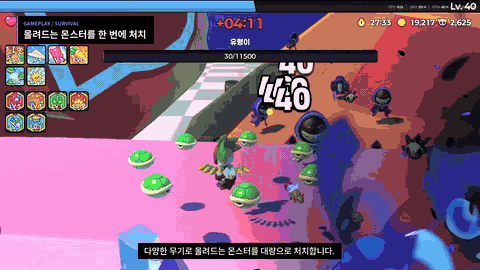 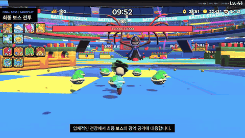

<sub>왼쪽: 몰려드는 수백 마리의 몬스터를 다양한 무기로 처치 · 오른쪽: 포탈을 지나 진입하는 최종 보스전</sub>

</div>

<br>

## 📌 프로젝트 개요

| 항목 | 내용 |
| --- | --- |
| **장르** | 3D 뱀서라이크 + 장애물 액션 |
| **개발 형태** | 팀 프로젝트 (4인) |
| **맡은 역할** | 개발 — **Enemy · Boss · 맵 · 인게임 흐름** |
| **개발 기간** | 2026.05.04 – 2026.05.29 (약 4주) |
| **개발 환경** | Unity 6 (6000.4.5f1), C#, URP |
| **목표** | 3D 인게임 환경에서 수백 마리의 몬스터를 프레임 저하 없이 움직이고, 하나의 런으로 연결하자 |

<br>

## 🎮 게임 소개

> 캐릭터를 골라 몰려드는 적 웨이브 속에서 살아남고, 경험치로 무기 · 패시브를 강화하며 **장애물 스테이지와 보스**를 돌파하는 3D 뱀서라이크입니다.

<table>
<tr>
<td width="50%">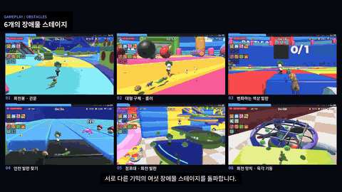</td>
<td width="50%">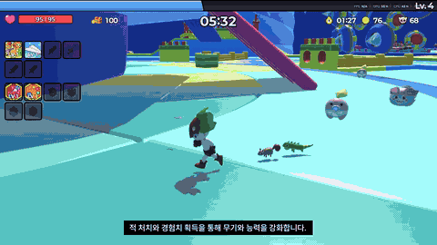</td>
</tr>
<tr>
<td align="center"><sub>서로 다른 기믹의 장애물 스테이지 6개와 고유 패턴 보스 6종</sub></td>
<td align="center"><sub>회전 발판 · 이동 장애물을 통과해 스테이지 진행</sub></td>
</tr>
</table>

<br>

## 🙋 담당 구현 요약

| # | 구현 내용 | 핵심 결과 |
| :-: | --- | --- |
| 1 | [대량 Enemy 최적화](#1-대량-enemy-최적화) | ManagedUpdate · 오브젝트 풀링 · VAT + GPU Instancing · Grid 공간 분할 |
| 2 | [NavMesh 없는 다층 추적 로직](#2-navmesh-없는-다층-지형-추적) | 플레이어 XZ 추적 + 단차별 Low / High Raycast로 지면 Y 보정 |
| 3 | [Enemy · Boss 상속 구조](#3-enemy--boss-상속-구조) | `IDamageable` 공통 계약 · 일반 6종 / 보스 9종 확장 |
| 4 | [인게임 흐름 설계](#4-인게임-흐름--so-데이터) | 웨이브 페이즈 → 장애물 스테이지 → 중간 보스 ×6 → 최종 보스, SO 데이터로 구성 |

### 📊 최적화 성과 한눈에 보기

| 최적화 | 지표 (Profile Analyzer 중앙값) | Before | After | 변화 |
| --- | --- | ---: | ---: | ---: |
| **ManagedUpdate** | BehaviourUpdate | 7.17 ms | 6.45 ms | **−10%** |
| | 프레임당 Update 호출 진입점 | ≈1,000 | 1 | |
| **오브젝트 풀링** | 생성 · 파괴 GC 할당 | 지속적인 스파이크 | 처음에만 할당 | |
| **VAT + GPU Instancing** | Animators.Update | 2.67 ms | 0.07 ms | **−97.4%** |
| | 프레임 시간 (PlayerLoop) | 25.34 ms | 17.54 ms | **−30.8%** |
| | 적 드로우 | 748 인스턴스 | 30 드로우 | |
| **Grid 공간 분할** | EnemyManager.Separation | 187.07 ms | 4.06 ms | **−97.8%** |
| | 프레임 시간 (PlayerLoop) | 219.3 ms | 17.3 ms | **−92.1%** (4.6 → 57.7 fps) |

<sub>측정 환경: Unity 6 Editor · i5-12400F / RTX 3060 · 적 약 1,000마리 · 같은 씬 · 같은 적 수에서 적용 전/후 캡처 비교</sub>

<br>

<p align="center">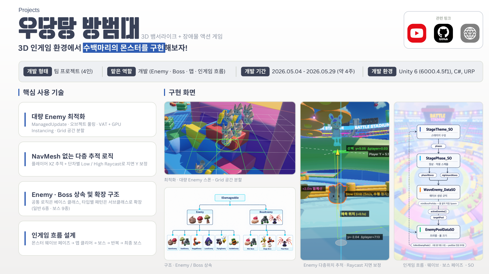</p>

---

## 1. 대량 Enemy 최적화

<p align="center">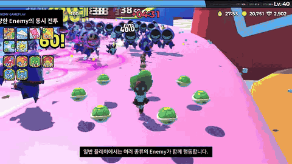<br><sub>일반 플레이에서도 여러 종류의 Enemy가 동시에 전투</sub></p>

### 1-1. 통합 업데이트 시스템 — ManagedUpdate

> **분산된 Enemy 갱신을 `EnemyManager`의 중앙 루프로 통합**

| | 내용 |
| --- | --- |
| **문제 상황** | Unity가 수백 마리 Enemy의 `Update()`를 개별 호출해, 개체 수만큼 호출 진입점이 증가 |
| **판단** | 하나의 `ManagedUpdate`에서 순회하며 실행하는 구조가 필요 |
| **결과** | 프레임당 Update 호출 965회 → 0회, BehaviourUpdate 중앙값 **7.17 → 6.45 ms (−10%)** |

<p align="center">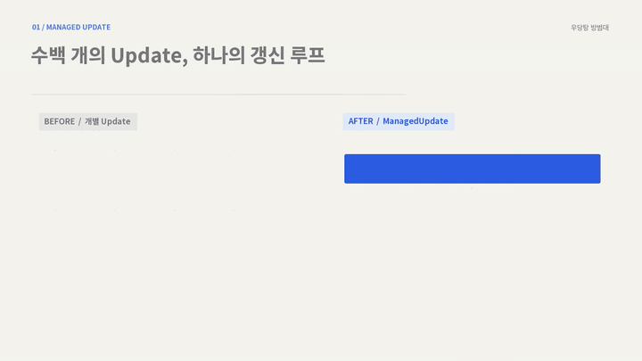</p>

```csharp
// EnemyManager.cs — 활성 Enemy를 하나의 루프에서 갱신
float dt = Time.deltaTime;

gridUpdateTimer += dt;
if (gridUpdateTimer >= gridUpdateInterval)   // 0.15초마다 Grid 재등록
{
    gridUpdateTimer = 0f;
    UpdateGrid();
}

for (int i = activeEnemies.Count - 1; i >= 0; i--)
    activeEnemies[i].ManagedUpdate(dt);
```

### 1-2. 오브젝트 풀링

> **스폰 · 사망 중심의 생성 · 파괴를 대기 풀과 활성 객체의 재사용 순환으로 변경**

| | 내용 |
| --- | --- |
| **문제 상황** | 수백 마리 Enemy의 생성과 파괴가 반복되어 `Instantiate` / `Destroy` 비용과 GC 스파이크, 메모리 할당 증가 |
| **적용 대상** | 적 생명주기(스폰 · 피격 · 사망)에서 생기는 4종 — **Enemy · 데미지 텍스트 · 경험치 구슬 · 코인** |
| **결과** | 지속적으로 발생하던 GC 스파이크가 사라지고, 처음에만 할당한 뒤 이후 할당 0 |

<p align="center">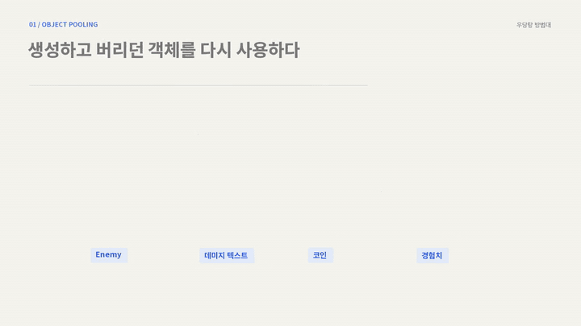</p>

### 1-3. VAT + GPU Instancing

> **SkinnedMesh 기반 애니메이션을 VAT 재생과 인스턴싱 가능한 MeshRenderer 구조로 전환**

| | 내용 |
| --- | --- |
| **문제 상황** | 수백 마리의 `SkinnedMeshRenderer` · `Animator`가 동시에 갱신되어 본 갱신과 개별 드로우 제출 비용이 누적 |
| **판단** | 애니메이션 계산을 CPU에서 GPU로 옮기고, 동일 메시를 인스턴싱으로 묶어야 함 |
| **적용** | SmartVAT로 Idle · Move · Attack · Death 클립을 정점 위치 · 노멀 텍스처로 베이크 → Animator · SkinnedMeshRenderer 제거, MeshRenderer + MeshFilter만 유지 → 셰이더가 시간으로 텍스처 프레임을 샘플링 → 동일 Mesh · Material에 GPU Instancing |
| **결과** | Animators.Update **2.67 → 0.07 ms (−97%)**, 프레임 내 Animator 비중 10.05% → 0.43%, 렌더링 3.98 → 1.85 ms, 풀 재활성 3.23 → 0.70 ms, 적 748 인스턴스 → **30 드로우** |

<p align="center">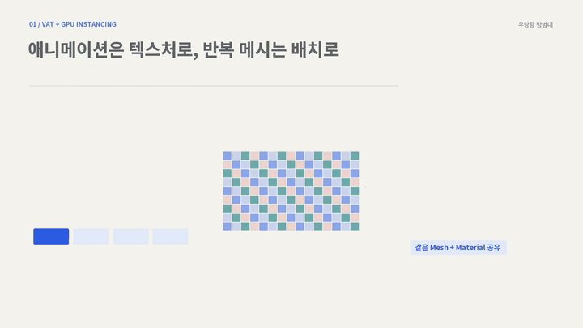</p>

### 1-4. Grid 공간 분할 분리 계산

> **전체 Enemy 비교를 주변 3×3 셀 탐색으로 제한해 분리 힘 계산 범위를 축소**

| | 내용 |
| --- | --- |
| **문제 상황** | Enemy끼리 겹치지 않게 Unity 물리 충돌을 쓰면 충돌 계산과 물리 콜백 비용이 누적되어 프레임 저하 |
| **판단** | Rigidbody 없이 충돌과 자연스러운 분산을 구현할 방안이 필요 |
| **동작 순서** | ① 0.15초마다 활성 Enemy를 2m Grid 셀에 재등록 → ② 기준 Enemy의 셀 확인 → ③ 주변 3×3 셀의 후보만 순회 → ④ 분리 반경 1.5m 안의 이웃을 최대 5마리 확인해 반대 방향 힘을 이동에 합산 |
| **결과** | Separation **187.07 → 4.06 ms (−97.8%)**, 프레임 시간 219.3 → 17.3 ms, 거리 비교 횟수 ≈83.9만 → ≤3.1만 (N² → N×32) |

<p align="center">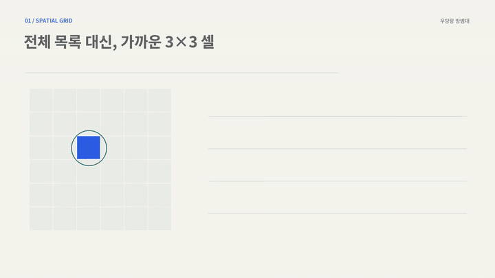</p>

```csharp
// EnemyManager.cs — 주변 3×3 셀만 조회, 이웃은 최대 5마리
Vector2Int cell = GetCellPos(targetEnemy.transform.position);
const int MAX_CHECKS = 5;

for (int x = -1; x <= 1; x++)
for (int y = -1; y <= 1; y++)
{
    if (!spatialGrid.TryGetValue(new Vector2Int(cell.x + x, cell.y + y), out List<Enemy> neighbors))
        continue;

    for (int i = 0; i < neighbors.Count; i++)
    {
        if (checkCount >= MAX_CHECKS) return force;
        ...
        if (sqrDist > 0 && sqrDist < sqrRadius)
        {
            force += diff.normalized / Mathf.Sqrt(sqrDist);   // 가까울수록 강하게 밀어냄
            checkCount++;
        }
    }
}
```

<details>
<summary>📑 포트폴리오 슬라이드 보기 (ManagedUpdate · 오브젝트 풀링 · VAT · 공간 분할 · 성능 비교)</summary>
<br>
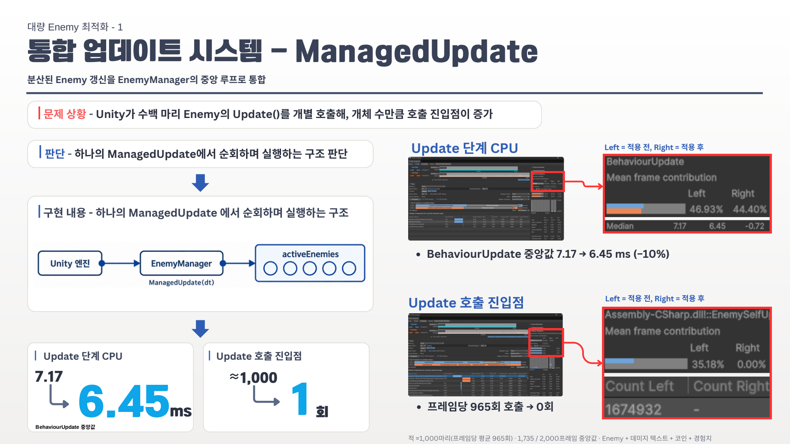
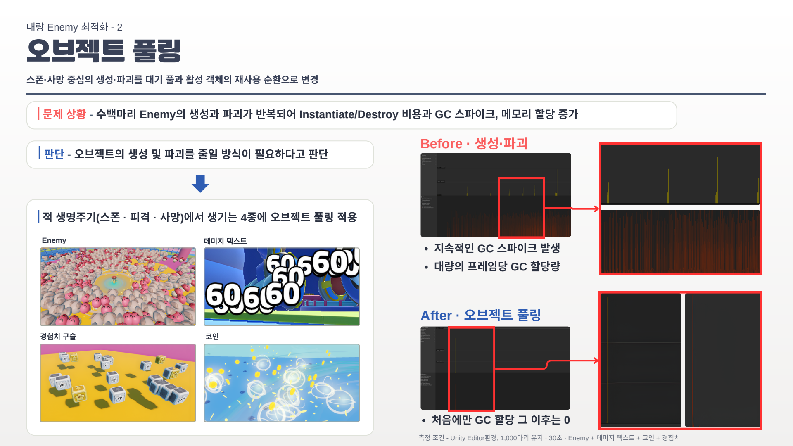
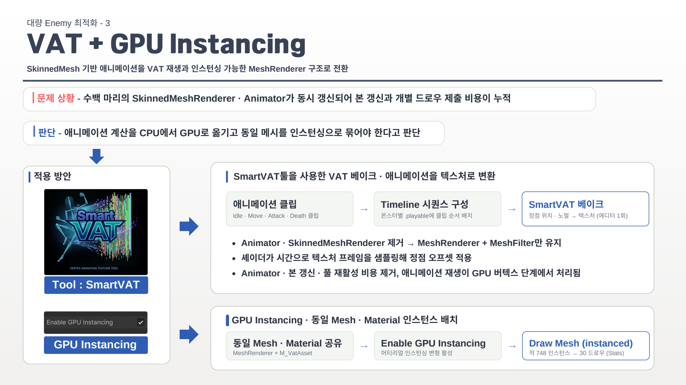
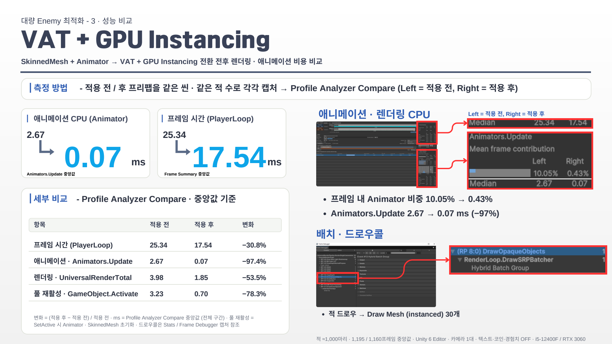
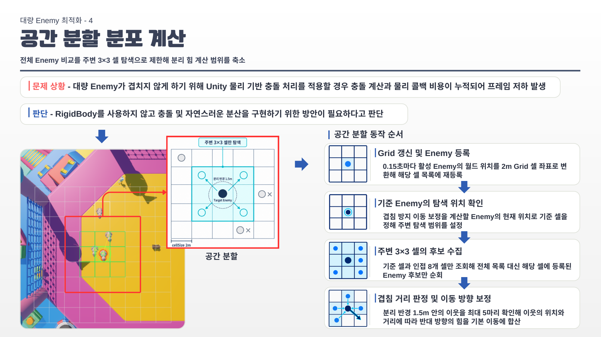
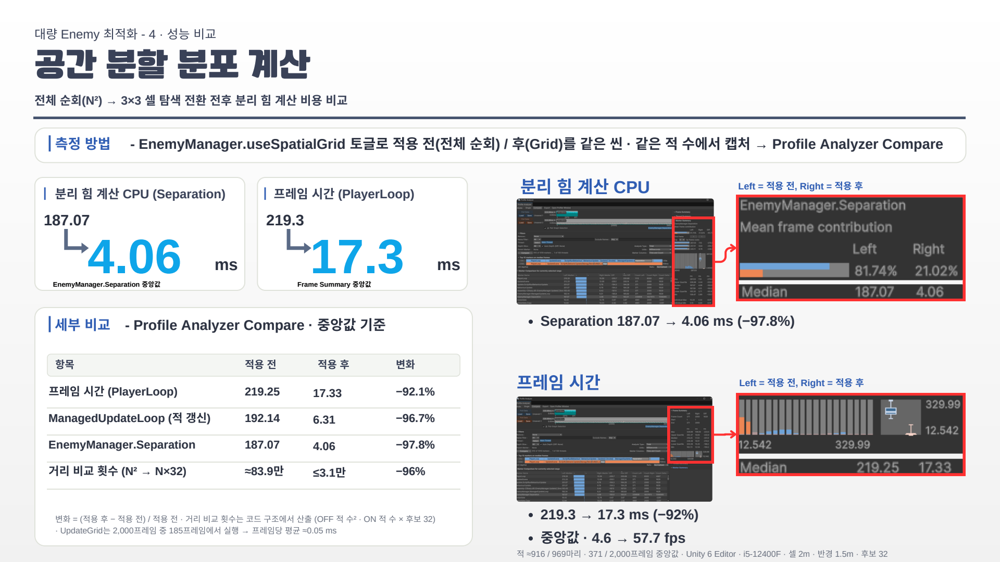
</details>

📂 **관련 코드** — [`EnemyManager.cs`](VehicleSurvivor/Assets/02.%20Scripts/GamePlay/Enemy/EnemyManager.cs) · [`Enemy.cs`](VehicleSurvivor/Assets/02.%20Scripts/GamePlay/Enemy/Enemy.cs) · [`EnemyPoolDataSO.cs`](VehicleSurvivor/Assets/02.%20Scripts/GamePlay/Enemy/Enemy_Game_Data/EnemyPoolDataSO.cs)
<br>🧪 **측정 · 디버그 도구** (측정용 브랜치) — [`BenchmarkRecorder.cs`](https://github.com/chlwnsdud2025/Clumsy-Defense-Force-Portfolio/blob/main/VehicleSurvivor/Assets/02.%20Scripts/Benchmark/BenchmarkRecorder.cs) · [`EnemySpatialGridGizmo.cs`](https://github.com/chlwnsdud2025/Clumsy-Defense-Force-Portfolio/blob/main/VehicleSurvivor/Assets/02.%20Scripts/Editor/EnemySpatialGridGizmo.cs)

---

## 2. NavMesh 없는 다층 지형 추적

> **같은 XZ에 여러 층이 겹치는 지형에서, Enemy가 목표 층을 판단하지 못하는 문제를 해결**

<table>
<tr>
<td width="50%">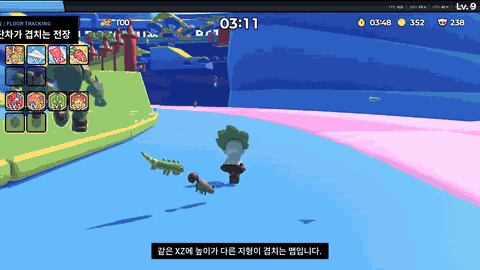</td>
<td width="50%">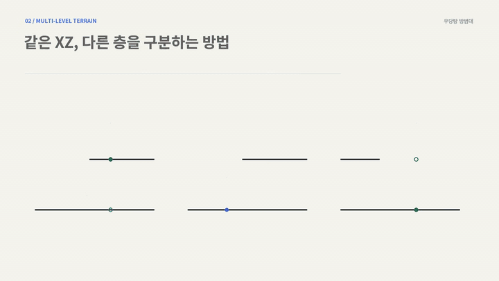</td>
</tr>
<tr>
<td align="center"><sub>단차가 겹치는 전장에서 플레이어를 따라오는 Enemy</sub></td>
<td align="center"><sub>위층 · 같은 층 · 절벽 아래, 세 가지 경우의 층 판단</sub></td>
</tr>
</table>

| | 내용 |
| --- | --- |
| **문제 상황** | 다층 구조 맵에서 수백 마리가 NavMesh를 쓰면 경로 계산이 과도하게 발생 |
| **판단** | NavMesh 없이 대량의 몬스터가 쓸 수 있는 다층 지형 이동 방식이 필요 |
| **구조** | XZ는 플레이어를 직접 추적하고, 높이(Y)만 0.1초마다 이동 예측 위치에서 Raycast로 보정 |

| 레이 | 사용 조건 | 동작 |
| --- | --- | --- |
| **Low Ray** · `Raycast` | 플레이어가 같은 층 (기본 경로 · 비용 최소) | 예측 위치의 발 위 2m에서 아래로 4m 발사 → 히트하면 그 바닥 높이로 유지, MISS(절벽 · 큰 단차)면 High Ray로 재탐색 |
| **High Ray** · `RaycastNonAlloc` | 플레이어가 2m 이상 위층에 있거나 Low Ray가 MISS | 플레이어 Y + 5m 위에서 아래로 발사 → 관통한 모든 층의 바닥 히트 중 **플레이어 Y와 가장 가까운 층**을 목표로 선택 |

| 상황 | 판단 |
| --- | --- |
| 플레이어가 위층 (높이차 ≥ 2m) | High Ray → 관통 히트 중 Player Y 최근접 = 2F 선택 → 목표 높이까지 Slow Climb ↑ |
| 플레이어가 아래층 (절벽 · 큰 단차) | Low Ray MISS → High Ray fallback → 1F 선택 → 낙하 ↓ |
| 플레이어와 같은 층 | Low Ray 히트 → 현재 층 유지 (High Ray 미사용 · 최소 비용) |

```csharp
// Enemy.cs — High Ray: 관통한 모든 바닥 중 플레이어 높이와 가장 가까운 층 선택
int hitCount = Physics.RaycastNonAlloc(highRayStart, Vector3.down, hitBuffer, raycastDistance, groundLayer);
float closestDiff = float.MaxValue;
for (int i = 0; i < hitCount; i++)
{
    float diff = Mathf.Abs(hitBuffer[i].point.y - playerTarget.position.y);
    if (diff < closestDiff)
    {
        closestDiff = diff;
        cachedTargetHeight = hitBuffer[i].point.y;
        cachedHitGround = true;
    }
}
```

<details>
<summary>📑 포트폴리오 슬라이드 보기 (다층 지형 추적 로직)</summary>
<br>
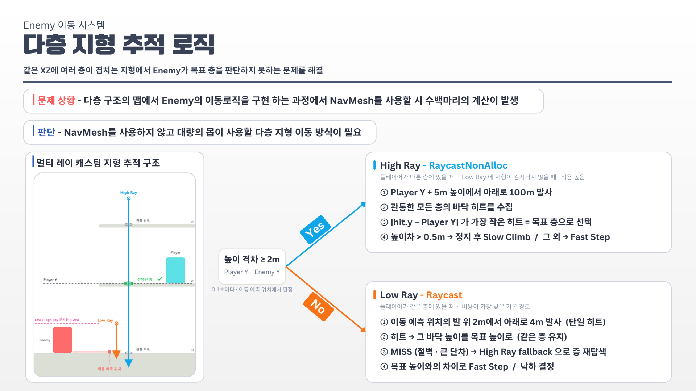
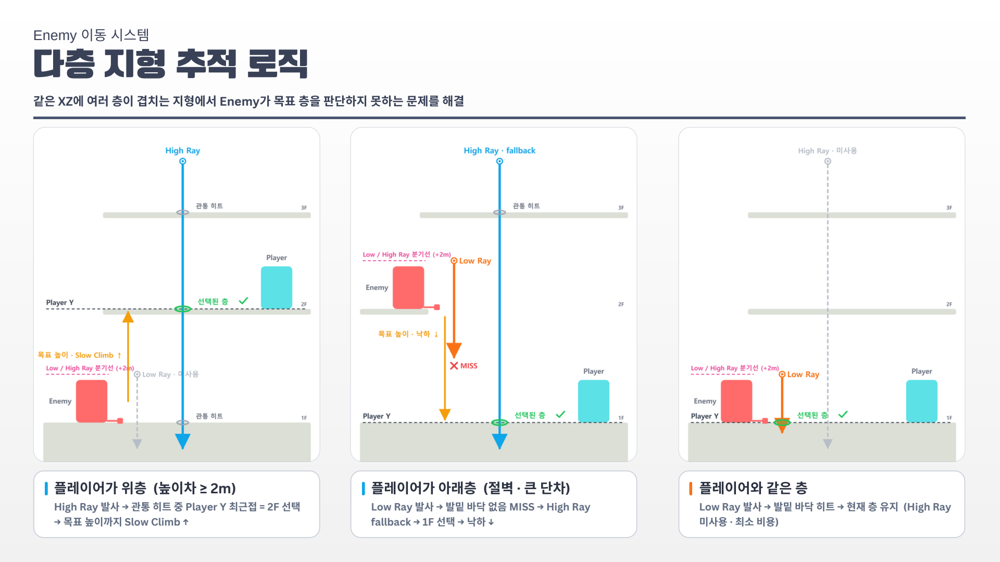
</details>

📂 **관련 코드** — [`Enemy.cs`](VehicleSurvivor/Assets/02.%20Scripts/GamePlay/Enemy/Enemy.cs) · [`BossEnemy.cs`](VehicleSurvivor/Assets/02.%20Scripts/GamePlay/Enemy/Boss/BossEnemy.cs)
<br>🧪 **디버그 도구** — [`EnemyFloorTrackingGizmo.cs`](https://github.com/chlwnsdud2025/Clumsy-Defense-Force-Portfolio/blob/main/VehicleSurvivor/Assets/02.%20Scripts/Editor/EnemyFloorTrackingGizmo.cs)

---

## 3. Enemy · Boss 상속 구조

> **`IDamageable`을 공통 계약으로 유지하고, 일반 Enemy와 Boss의 책임에 맞게 기반 클래스를 분리**

<table>
<tr>
<td width="50%">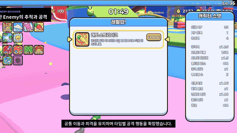</td>
<td width="50%">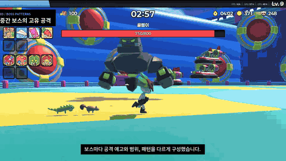</td>
</tr>
<tr>
<td align="center"><sub>일반 Enemy — 공통 이동 위에 타입별 공격 행동</sub></td>
<td align="center"><sub>중간 보스 — 독립 갱신과 코루틴으로 고유 패턴 실행</sub></td>
</tr>
</table>

| 구분 | `Enemy` (일반 6종) | `BossEnemy` (보스 9종) |
| --- | --- | --- |
| **대상** | 수백 마리 일반 Enemy의 효율적인 관리 | 소수 Boss의 고유 공격 패턴 관리 |
| **갱신** | `ManagedUpdate`에서 활성 개체를 일괄 갱신 | 각 Boss가 독립 `Update`와 `Coroutine`으로 패턴 실행 |
| **확장** | `virtual` 메서드로 필요한 동작만 선택적으로 재정의 | `abstract Attack()` 구현을 모든 Boss 클래스에 강제 |
| **사망** | Object Pool로 반환 | 사망 이벤트 발행 후 오브젝트 제거 |
| **하위 타입** | Basic · Dash · Range · Laser · Flying · Suicide | Bee · Volcano · Phantom · Scorpion · Spider · Twin(Geezer · Queen) · 중간 보스 · Final |

**공통 구조** — 둘 다 `MonoBehaviour`를 상속하고 `IDamageable`을 구현. 이동 · 피격 · 사망과 공격 진입점은 상위 클래스가 관리하고, 하위 클래스는 필요한 이동 방식과 공격 동작만 재정의 · 추가합니다.

<details>
<summary>📑 포트폴리오 슬라이드 보기 (Enemy · Boss 구조 · 클래스 다이어그램)</summary>
<br>
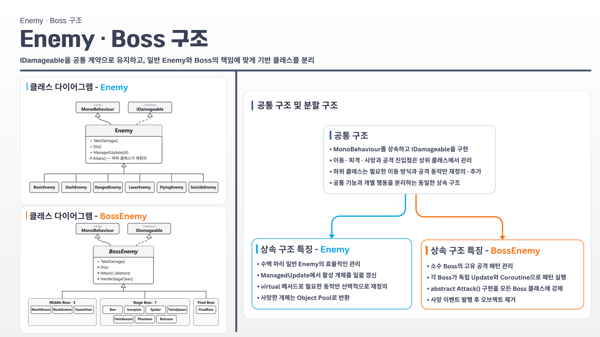
</details>

📂 **관련 코드** — [`Enemy.cs`](VehicleSurvivor/Assets/02.%20Scripts/GamePlay/Enemy/Enemy.cs) · [`EnemyType/`](VehicleSurvivor/Assets/02.%20Scripts/GamePlay/Enemy/EnemyType) · [`BossEnemy.cs`](VehicleSurvivor/Assets/02.%20Scripts/GamePlay/Enemy/Boss/BossEnemy.cs) · [`BossType/`](VehicleSurvivor/Assets/02.%20Scripts/GamePlay/Enemy/Boss/BossType) · [`BossPatturn/`](VehicleSurvivor/Assets/02.%20Scripts/GamePlay/Enemy/Boss/BossPatturn)

---

## 4. 인게임 흐름 — SO 데이터

> **시간 제한 페이즈 → 장애물 스테이지 클리어 → 중간 보스 → 다음 페이즈를 6회 반복한 뒤, 포탈을 통해 최종 보스전으로 전환되는 런 구조**

<table>
<tr>
<td width="50%">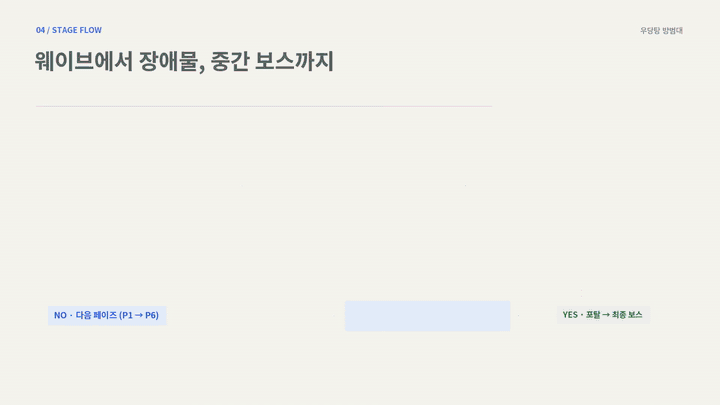</td>
<td width="50%">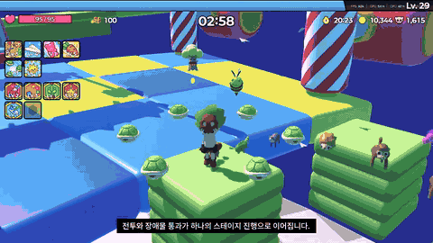</td>
</tr>
<tr>
<td align="center"><sub>웨이브 페이즈 → 장애물 스테이지 → 중간 보스</sub></td>
<td align="center"><sub>제한 시간을 넘기면 악몽(Nightmare) 웨이브로 전환</sub></td>
</tr>
</table>

| 데이터 | 역할 |
| --- | --- |
| **Theme** (`StageTheme_SO`) | 테마에서 쓸 Enemy 풀 목록과 페이즈 7개(0~6)를 순서대로 보유 |
| **Phase** | 제한 시간 + 정상 웨이브 목록 / 시간 초과 시 악몽 웨이브 목록 |
| **Wave** (`WaveEnemy_DataSO`) | 시작 시각 · 간격 · 마리 수 · 적 구성(풀 + 가중치 %) · 미니보스 |
| **Enemy** (`EnemyPoolDataSO`) | 프리팹 · 풀 크기 · 예비 상한 |

- **진행 루프** — `StageRunManager`가 페이즈 진행, 장애물 스테이지, 중간 보스, 포탈과 최종 보스 전환을 관리
- **Theme SO 커스텀 인스펙터** — 페이즈 구성 막대(제한 시간 비율로 P1~P7 분할), 정상 / Nightmare 웨이브 타임라인, 웨이브 표(시작 · 지속 · 간격 · 마리 · 마리/초 · 보스 · 적 구성)를 한 화면에 표시. 행 클릭으로 웨이브 에셋 핑, Ctrl+클릭으로 해당 SO로 이동
- **팀원 작업 편의** — 코드를 수정하지 않고 인스펙터에서 웨이브와 패턴을 조정

<p align="center">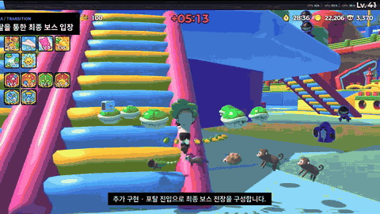<br><sub>6페이즈 이후 포탈을 통해 최종 보스 필드로 전환</sub></p>

<details>
<summary>📑 포트폴리오 슬라이드 보기 (인게임 플로우 · SO 데이터 · 커스텀 인스펙터)</summary>
<br>
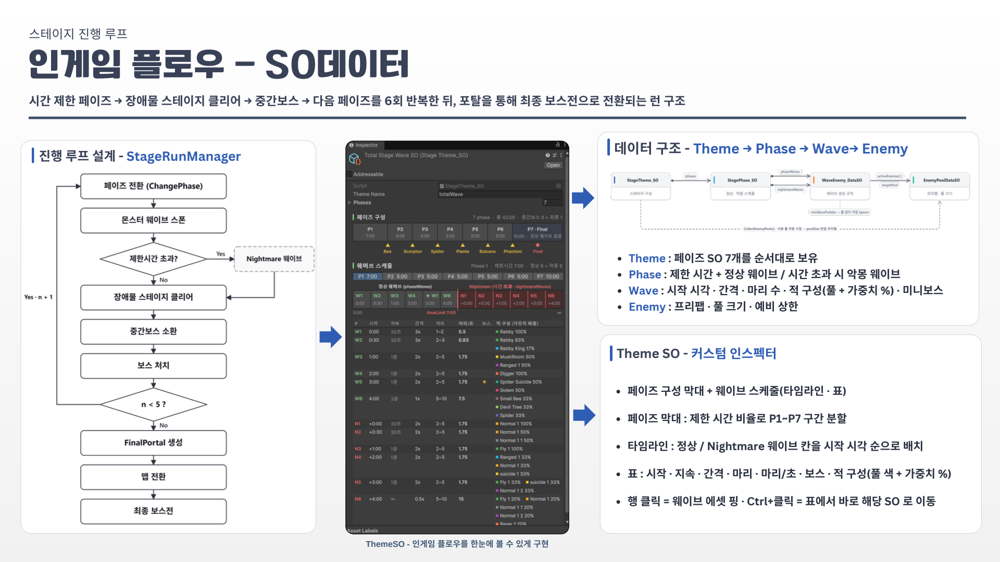
</details>

📂 **관련 코드** — [`StageRunManager.cs`](VehicleSurvivor/Assets/02.%20Scripts/GamePlay/Enemy/Enemy_Game_Data/new/StageRunManager.cs) · [`StageTheme_SO.cs`](VehicleSurvivor/Assets/02.%20Scripts/GamePlay/Enemy/Enemy_Game_Data/new/StageTheme_SO.cs) · [`WaveEnemy_DataSO.cs`](VehicleSurvivor/Assets/02.%20Scripts/GamePlay/Enemy/Enemy_Game_Data/new/WaveEnemy_DataSO.cs) · [`RunTimers.cs`](VehicleSurvivor/Assets/02.%20Scripts/GamePlay/Runtime/RunTimers.cs)
<br>🧪 **커스텀 인스펙터** (디버그 브랜치) — [`StageScheduleDrawer.cs`](https://github.com/chlwnsdud2025/Clumsy-Defense-Force-Portfolio/blob/main/VehicleSurvivor/Assets/02.%20Scripts/Editor/StageScheduleDrawer.cs)

---

## 💡 배운 점

- **측정 → 원인 → 적용 → 재측정** — Profiler와 Profile Analyzer로 같은 조건의 전후를 비교하며, 감이 아닌 수치로 최적화 효과를 확인하는 방식으로 작업했습니다.
- **팀원을 위한 데이터 구조** — LastEmber에서 익힌 SO · 커스텀 인스펙터 경험을 살려, 팀원이 코드를 수정하지 않고도 웨이브와 패턴을 조정할 수 있게 설계했습니다.

<br>

## 🧰 기술 스택

| 분류 | 사용 기술 |
| --- | --- |
| **Engine** | Unity 6 (6000.4.5f1), URP |
| **Language** | C# |
| **Optimization** | Object Pooling, SmartVAT (Vertex Animation Texture), GPU Instancing, Spatial Grid |
| **Profiling** | Unity Profiler, Profile Analyzer, Frame Debugger |
| **Collaboration** | Git, GitHub |

<br>

<details>
<summary>🛠 실행 방법 · 조작 · 코딩 컨벤션 (팀 문서)</summary>

### 실행 방법

| 항목 | 내용 |
|------|------|
| Unity 버전 | **6000.4.5f1** |
| 프로젝트 폴더 | `VehicleSurvivor/` |
| 시작 씬 (Build Settings 0번) | `Assets/01. Scenes/GamePlay/TitleScene.unity` |
| 인게임 씬 (Build Settings 1번) | `Assets/01. Scenes/GamePlay/InGameScene.unity` |

Unity Hub에서 `VehicleSurvivor` 폴더를 연 뒤 **Play**를 누르면 타이틀 씬부터 실행됩니다.

### 플레이 흐름

1. **타이틀** — 화면을 클릭해 시작
2. **캐릭터 선택** — 원하는 캐릭터 선택 후 게임 시작
3. **인게임** — 이동·회피, 자동/획득 무기로 적 처치, 경험치·레벨업 보상 선택, 스테이지 클리어

### 조작 (키보드·마우스)

| 입력 | 동작 |
|------|------|
| `W` `A` `S` `D` | 이동 |
| 마우스 | 시점(카메라) |
| `Space` | 점프 |
| `Left Shift` | 달리기 |

게임패드 입력도 지원합니다.

### 코딩 컨벤션

- **PascalCase**: 클래스, 메서드, 네임스페이스, 열거형, 프로퍼티, 코루틴 / **camelCase**: 필드, 지역 변수, 매개변수 / **상수**: `MAX_HEALTH`
- 인터페이스 `I` 접두사(`IDamageable`), 베이스 클래스 `Base` 접미사, 열거형 `E` 접두사(`EGameState`), 클릭 이벤트 `OnClick` 접두사
- 클래스 구성 순서: 중첩 클래스 → 상수 → 열거형 → 필드 → 프로퍼티 → 이벤트 → 생성자 → Unity 메시지 → 공개 메서드 → 비공개 메서드 → 버튼 이벤트

</details>

<br>

<div align="center">

**최준영 · Unity Client Developer**
📧 juny2221@gmail.com · ▶ [YouTube](https://www.youtube.com/channel/UCMoIuWbEUPRG-8-CIZpd6cQ)

</div>
